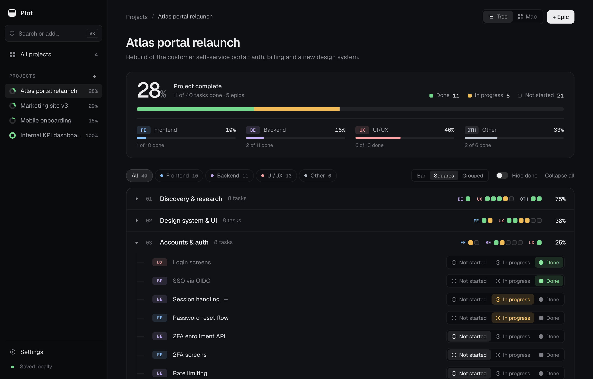
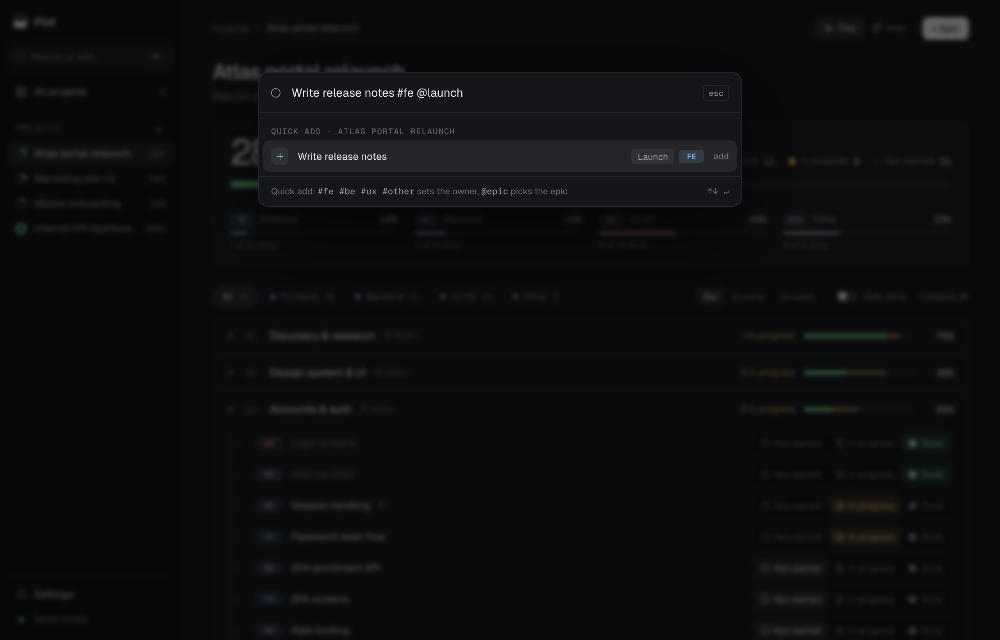
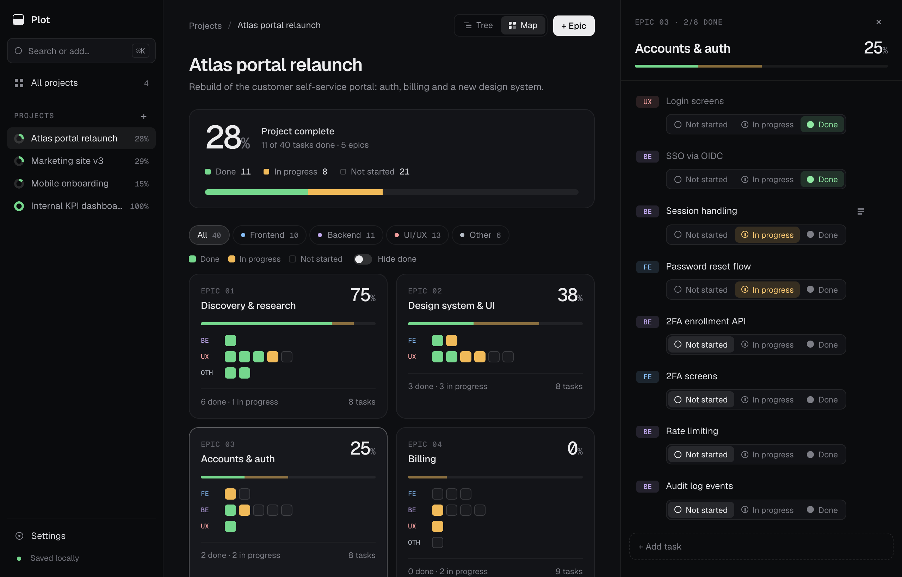
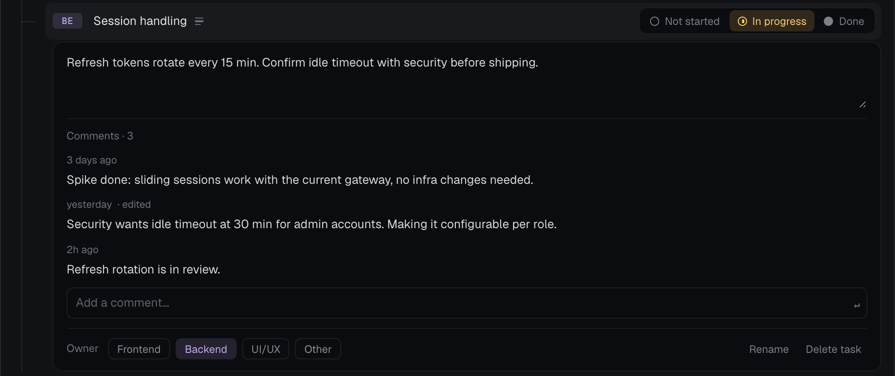
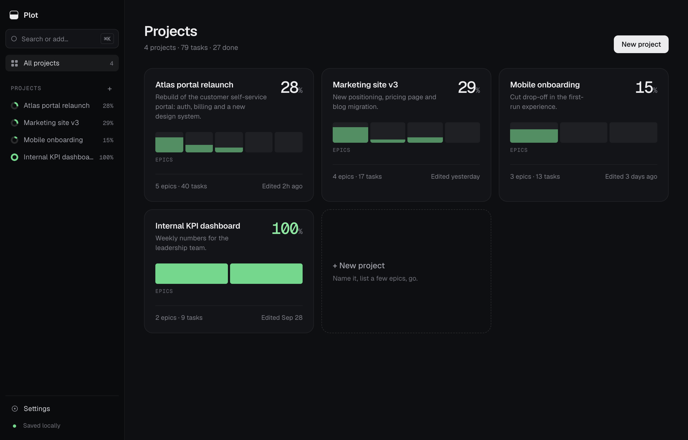

<p align="center">
  
</p>

<h1 align="center">Plot</h1>

<p align="center">
  <strong>A small, local-first project tracker for one person. Not another Jira.</strong>
</p>

<p align="center">
  <a href="https://github.com/oelburk/plot/releases/latest">Download for macOS</a> ·
  <a href="#develop">Build from source</a> ·
  <a href="docs/spec.md">Design spec</a>
</p>

<p align="center">
  
</p>

A project holds a few epics, an epic holds tasks, and every task has exactly one status and one owning discipline. Plot tells you how far along you are, per project, per epic and per discipline, and otherwise stays out of the way.

There are no accounts, assignees, due dates, sprints or workflows. Your data is saved on your Mac as you type and never leaves it.

## Features

- **One-click status.** Every task has an inline Not started / In progress / Done toggle.
- **Honest progress.** Percentages for the project, each epic and each discipline. Anything unfinished caps at 99%, so 100% always means done.
- **Tree and Map views.** Work through tasks in the tree, or see every epic at a glance on the map and open one in a side panel.
- **Your disciplines.** Frontend, Backend, UI/UX and Other out of the box. Rename them, recolour them, or add your own.
- **⌘K for everything.** Jump between projects, switch views, export, or add a task without leaving the keyboard.
- **Drag to re-arrange** epics and tasks, including moving a task into another epic.
- **Notes and comments.** Notes describe a task; timestamped comments track how it's going.
- **Undo** after any delete.
- **Portable data.** Export to JSON or CSV, and import a JSON export to restore or move machines.

## A closer look

**Quick add.** Type a task into ⌘K and tag it inline: `#fe` sets the discipline, `@launch` picks the epic.



**Map view.** Every epic as a tile, one square per task, grouped by discipline. Click a tile to work inside it.



**Comments.** Follow a task's progress without rewriting its notes.



**All projects.** Each card shows its epics as bars, so you can see what's moving.



## Keyboard

| Key | Action |
|---|---|
| <kbd>⌘</kbd> <kbd>K</kbd> | Open the command palette and quick add |
| <kbd>Esc</kbd> | Close the menu, palette, panel or open task |
| <kbd>Enter</kbd> / <kbd>Tab</kbd> | While adding a task: add it / cycle its discipline |
| <kbd>Enter</kbd> / <kbd>Shift</kbd> <kbd>Enter</kbd> | In a comment: post / new line |
| Double-click | Rename a project, epic or task |

## Install

Download `Plot_*_universal.dmg` from the [latest release](https://github.com/oelburk/plot/releases/latest). It runs natively on Apple Silicon and Intel Macs. Open the `.dmg` and drag `Plot.app` into Applications.

Plot isn't notarized by Apple, so macOS refuses to open it the first time ("can't be verified" or "is damaged"). Clear the download flag once in Terminal:

```bash
xattr -dr com.apple.quarantine /Applications/Plot.app
```

## Develop

Plot is Vite, React 19, TypeScript, Tailwind v4 and Zustand, wrapped in [Tauri 2](https://tauri.app).

```bash
npm install
npm run dev          # browser at http://localhost:5173
npm run tauri dev    # desktop window (needs Rust, see below)
npm test             # unit tests
```

`npm run tauri dev` also needs the Rust toolchain. If `cargo` isn't on your PATH, run `. "$HOME/.cargo/env"` or add that line to `~/.zshrc`.

The dev window (`localhost:5173`) and the installed `Plot.app` keep separate data.

### Build the app

```bash
npm run tauri build
open src-tauri/target/release/bundle/macos/Plot.app
```

Drag `Plot.app` into `/Applications` to keep it. Requires the Rust toolchain (`rustup`).

### Release

Bump `version` in `package.json`, `src-tauri/tauri.conf.json` and `src-tauri/Cargo.toml`, commit, then tag and push:

```bash
git tag v0.1.0 && git push origin v0.1.0
```

The Release workflow builds a universal `.dmg` and publishes it on the GitHub Releases page.

### Docs

- [`docs/design-handoff.md`](docs/design-handoff.md): the original design handoff, with every screen, token and behaviour.
- [`docs/spec.md`](docs/spec.md): the decisions made on top of it.

## License

[MIT](LICENSE)
